# Steam Achievement Manager

A modern Windows app for viewing and managing achievements and statistics in your Steam games — with a game library, rarity data, backups, history, stats and an optional Autopilot that runs games in the background.

Requires the [Steam client](https://store.steampowered.com/about/), a Steam account and network access. Steam must be running and you must be logged in.

> **Fair warning:** unlocking achievements you didn't earn (and idling games to add playtime) goes against Steam's rules and can be visible to others on your profile. Use it on your own account, at your own risk. Avoid games with anti-cheat.

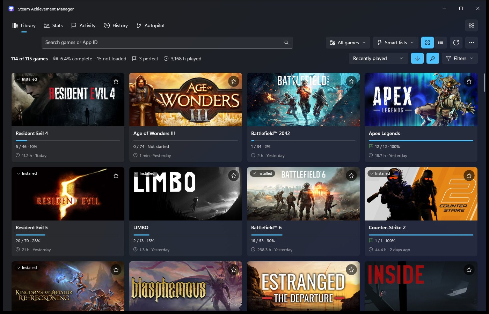

## Download and run

1. Download **`SAM.exe`** from the [latest release](https://github.com/Salijoghli/SteamAchievementManager/releases/latest).
2. Double-click it. That's it — nothing to install. .NET and everything else the app needs are inside the exe (about 65 MB).

Works on Windows 10 (1809+) and Windows 11, 64-bit. The first start takes a few seconds longer while Windows unpacks the app.

When a new version is out, SAM offers **Update now**: it downloads the new `SAM.exe`, checks it, swaps it in and restarts — no need to download it yourself again.

## Features

### Library
- All your games that have achievements, as cards (or a compact **list view**) with header art, achievement progress (`12 / 30 · 40%`), playtime and last played.
- Cards resize to your screen; a summary shows overall completion, perfect games and total playtime.
- **Search** by name or App ID (Ctrl+F). Typing an App ID you own that isn't listed offers to open it.
- **Sort** by recently played (default), name, App ID, playtime or completion.
- **Filters**: game type, favorites, completion state (not started / in progress / perfect) and last-played date (presets or a custom range).
- **Collections**: *Installed games*, your **Steam collections**, and your own SAM collections; hide games you don't want to see.
- **Smart lists**: *Almost perfect*, *Never started*, *Rarest owned* and *Easy wins* (games whose easiest locked achievement most players have).
- **Quick switcher**: press **Ctrl+K** anywhere, type a few letters (or initials like `hl2`, or an App ID) and press Enter to open a game.
- **Favorites** (per Steam account), pinned to the top.
- **Installed games** get a badge and a **Play** button (or **Install** if not installed).
- Right-click a game: open, unlock all, lock all, favorite, collections, hide, copy App ID, store page, community achievements page.
- **Export to CSV**: your library, or every achievement across all games.
- Games whose achievement data Steam hasn't sent yet show as **Not loaded**, with a **Load achievements** button.

| List view | Ctrl+K quick switcher |
|---|---|
| 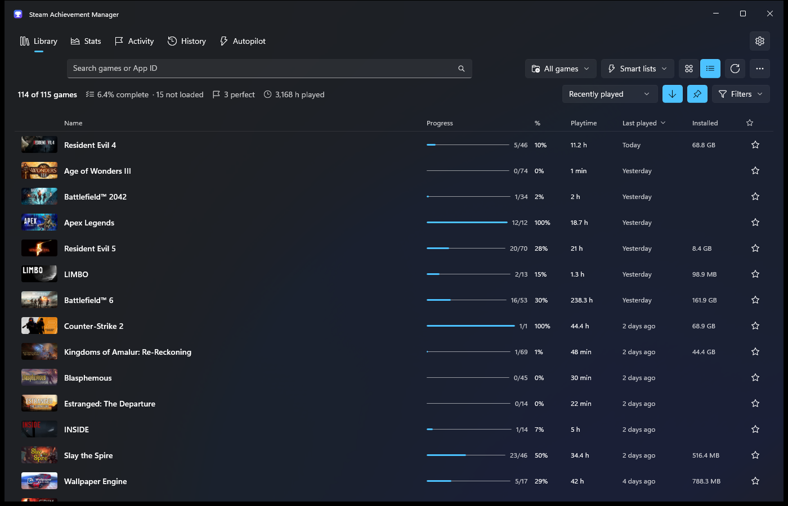 | 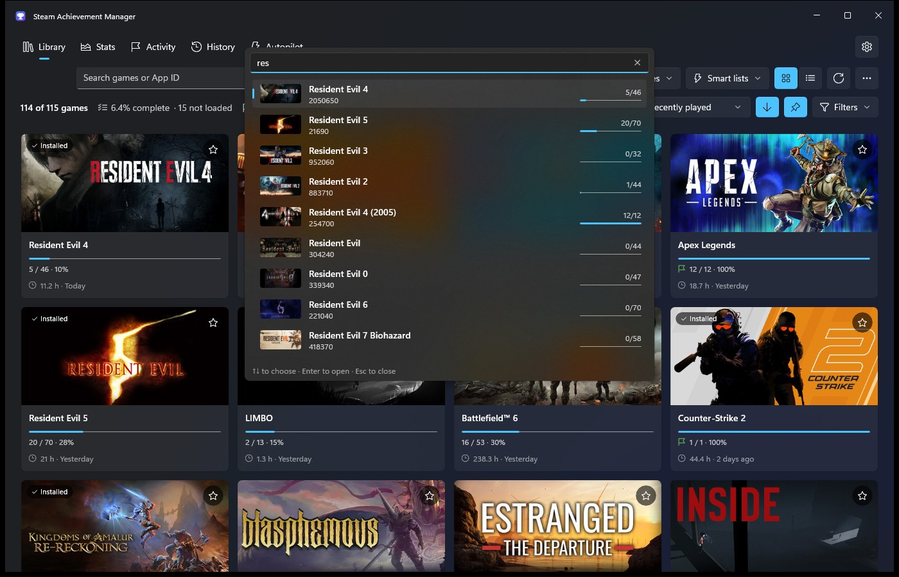 |

### Game window
- Every achievement with its icon, description, unlock date and **global rarity** ("4.2% of players", Common → Legendary).
- Search, filter (state, rarity, unlock date, has notes) and sort (rarity, unlock date, name).
- **Unlock all / Lock all / Invert** act on the achievements shown — search first to target a group.
- Nothing is changed until you press **Commit**, which shows a summary first. Commits are all-or-nothing and only report success once Steam's servers accept them.
- **Progress bars** on counter achievements ("340 / 1,000 kills"), read from the game's stats.
- **Timeline** tab: your unlocks in this game over time, as a chart or a table.
- **Compare with a friend**: pick a Steam friend and see which achievements they have (with dates) next to yours, then filter to *only they have*, *only you have*, *both* or *neither*. The picker lists only friends who own the game. Read from public Steam profiles; nothing is changed.
- **Statistics** tab (read-only until you allow editing), with validation and a list of the achievements that depend on each stat.
- **Backups**: taken automatically before every commit; restore any of them later (unlock dates can't be restored — Steam sets them when you commit).
- **Notes** on achievements, **guide links** (Steam guides / web search), and **spoiler protection** for hidden achievements.
- Protected achievements (that only the game's servers may change) are never touched.

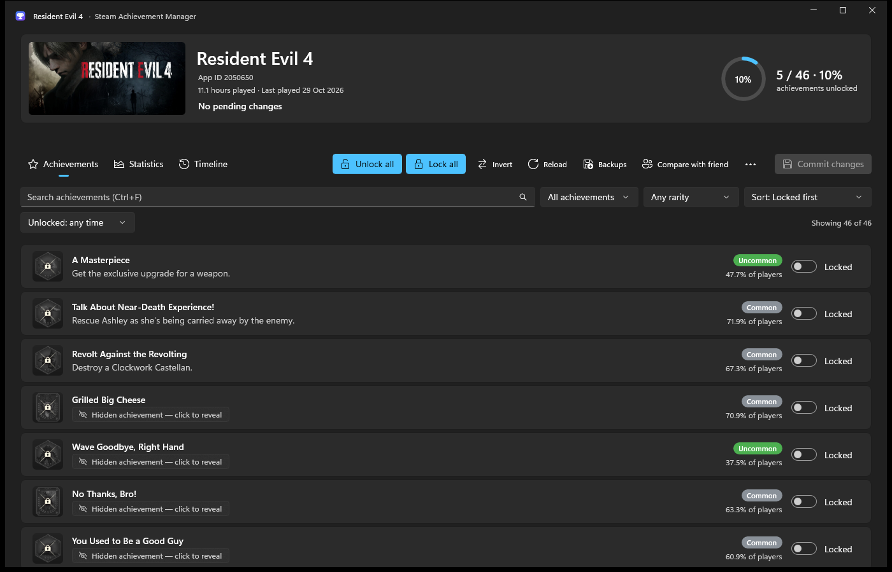

| Timeline | Compare with a friend |
|---|---|
| 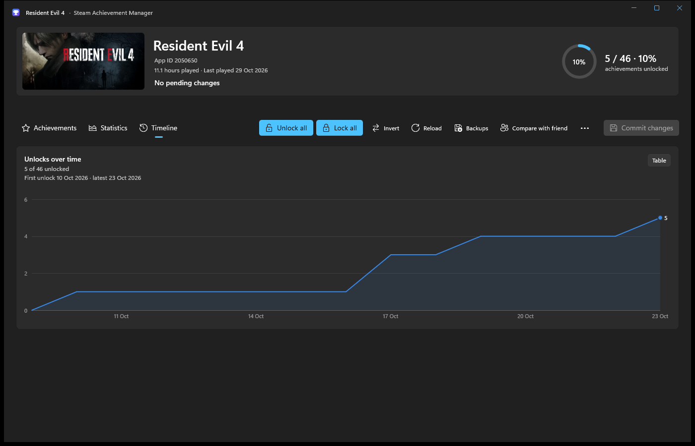 | 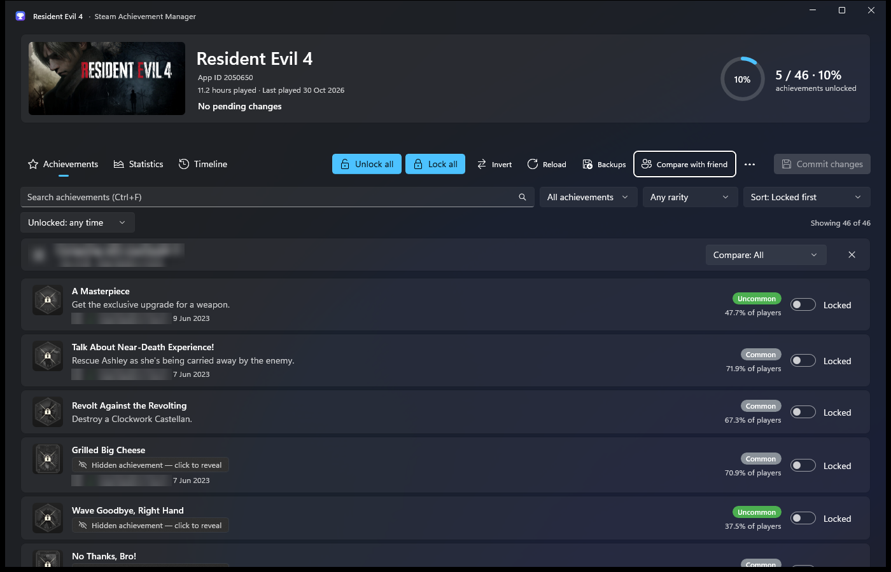 |

### Stats, Activity and History
- **Stats**: achievements unlocked, overall completion, perfect games, total playtime, a rarity-weighted *hunter score*, unlocks per month and over time, your rarest unlocks and top games.
- **Up next** (on Stats): the easiest achievements you're missing across all your games (the ones most players have) and the games closest to 100%.
- **Activity**: every unlock across all your games, newest first.
- **History**: every commit made with SAM — what changed, where it came from and whether it worked.

| Stats and Up next | Easy wins |
|---|---|
| 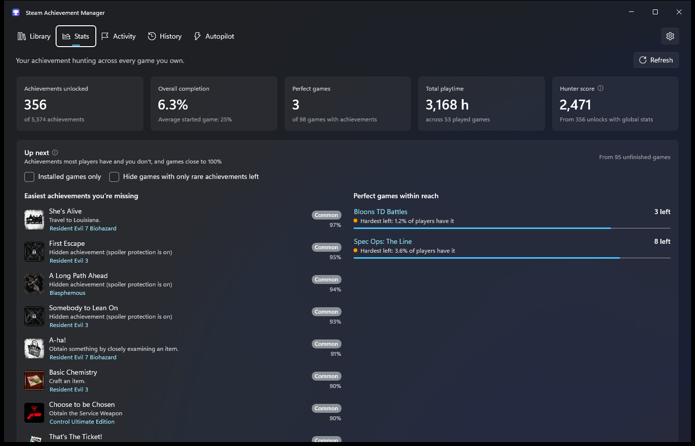 | 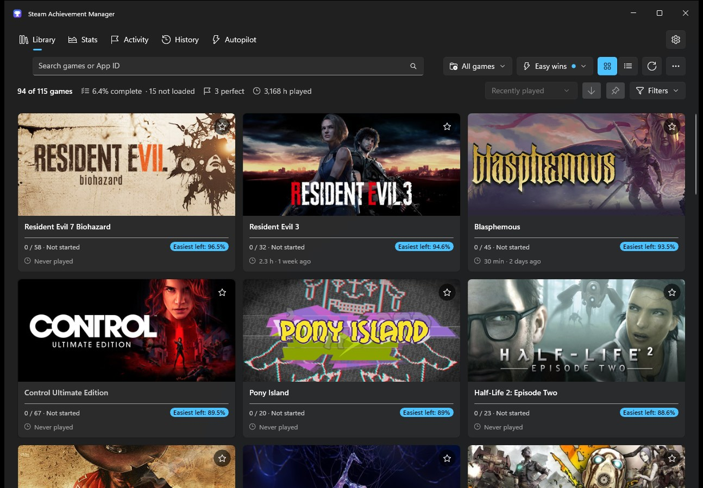 |

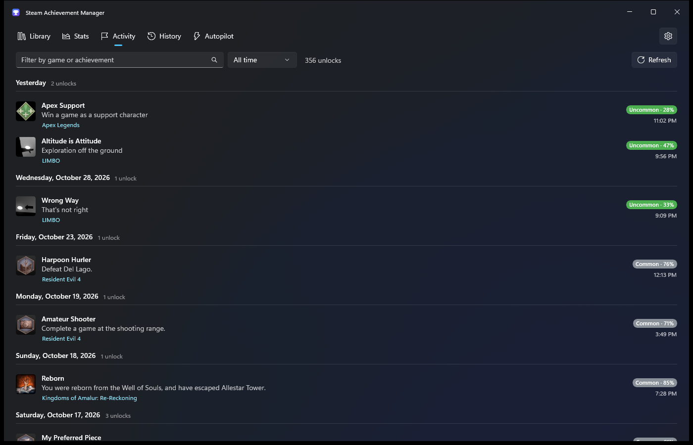

### Autopilot
Runs games in the background (Steam counts them as played) and unlocks achievements gradually, by rules you set:
- **Which games**: a manual list, all games with locked achievements, a collection, a smart list or installed games; exclusions; up to 32 at once; per-game overrides with an achievement checklist.
- **What to unlock**: minimum global percentage, include/exclude rare and hidden achievements, raise linked stats first.
- **Pacing**: by playtime (an editable rarity → hours curve, with a chart) or at a fixed interval, with random variation, an unlock order, and per-hour / per-day limits.
- **How long**: until a total playtime, for N more hours, or until everything allowed is unlocked.
- **Schedule**: active hours and days, quiet hours (no unlocks), a daily cap per game, pause while you're playing a real game.
- Built-in **Natural** and **Fast** presets, or your own. **Preview** shows exactly what would unlock and roughly when before you start.
- Backs up before every unlock and logs each one in History; runs from the system tray; optional start with Windows and resume after restart.

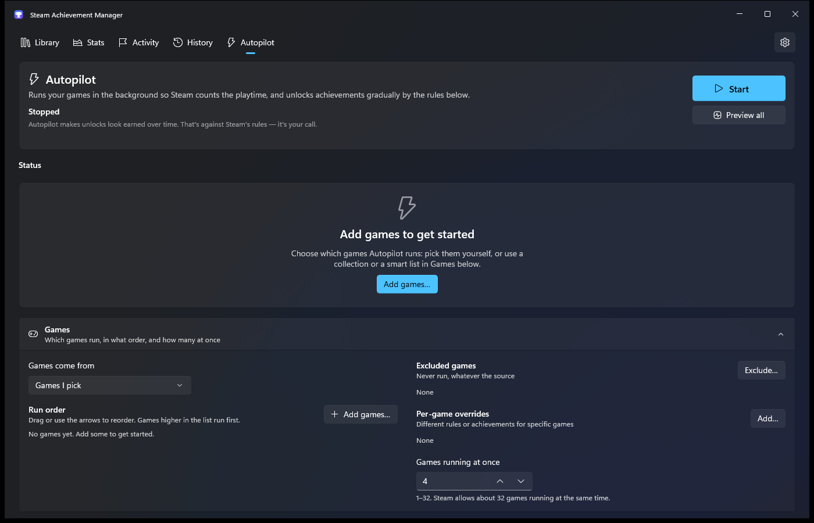

### Everything else
- **English and Georgian** (ქართული) — switch in Settings.
- Light / dark / system theme, Windows 11 Mica design.
- Downloads (game list, images, rarity data) are cached on disk, separately per Steam account; favorites, notes, backups and settings are never deleted by clearing the cache.
- **Unlock notifications**: when you earn an achievement while playing, SAM shows a Windows notification with its rarity ("Rare · 4.2% of players"). Turn it off in Settings.
- System tray, Windows notifications, and updates from this repository's releases.
- Command line, e.g. `SAM.exe 21690 --unlock ACH_ID --commit` (run `SAM.exe --help`).

Your data lives in `%LocalAppData%\SteamAchievementManager`.

| Light theme | ქართული |
|---|---|
| 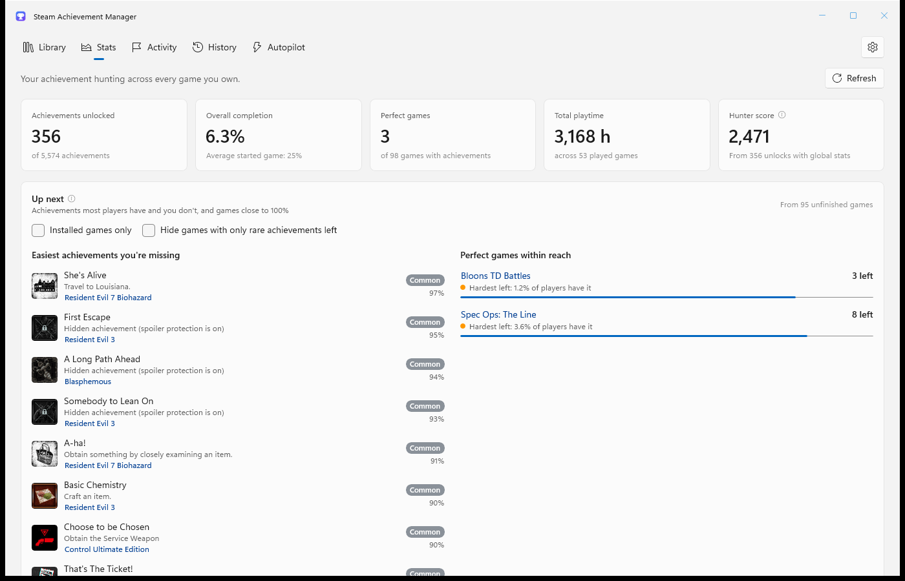 | 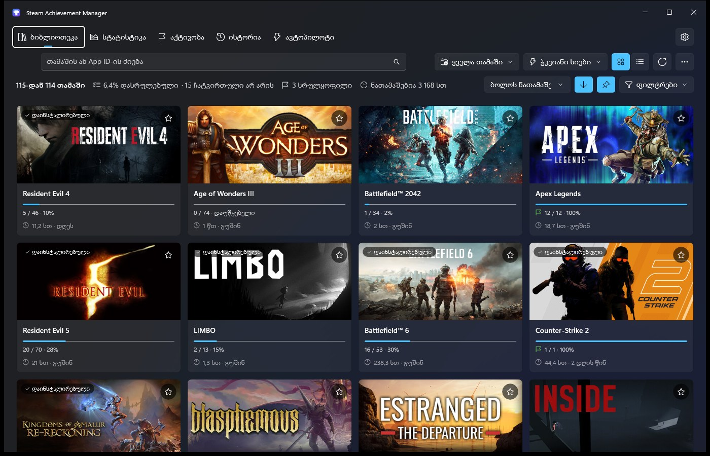 |

## Building

Requires Windows and the [.NET SDK](https://dotnet.microsoft.com/download) 8 or newer.

```powershell
.\build.ps1                     # single self-contained upload\SAM.exe
.\build.ps1 -Configuration Debug  # normal debug build in SAM.App\bin
dotnet test SAM.App.Tests -c Debug -p:Platform=x64
```

Every push is built and tested by GitHub Actions. Pushing a tag like `v8.2.0` publishes a release with `SAM.exe`.

The project is a WinUI 3 / .NET 8 app (`SAM.App`) on top of `SAM.API`, the original project's Steam client interop (now 64-bit).

## About this fork

This is a modified fork of [gibbed/SteamAchievementManager](https://github.com/gibbed/SteamAchievementManager) — it is not the original software. The original WinForms apps (SAM.Picker and SAM.Game) were replaced by the new app described above.

## Attribution

Originally created by Rick (gibbed). The original project's icons were from the [Fugue Icons](https://p.yusukekamiyamane.com/) set; the new app icon is generated by `tools/icon/make_icon.py`.
